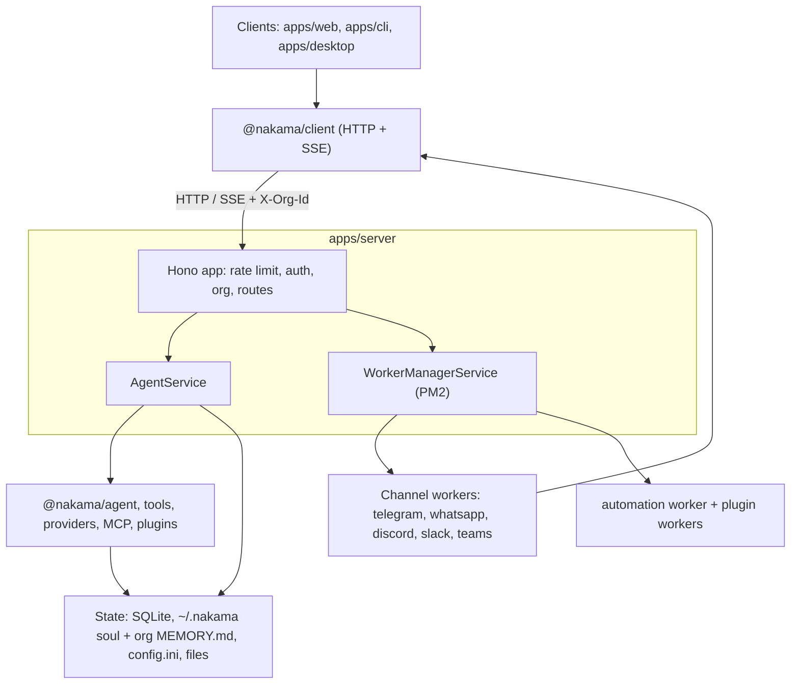

# Nakama Architecture

Nakama is an agent platform for teams. The platform does not replace the team. One shared server runtime serves thin clients.

The org is the isolation boundary. Profiles, sessions, tools, MCP, skills, automations, attachments, and usage are org-scoped unless they are platform-level.

Security trust boundaries, STRIDE analysis, and residual risks are maintained in
[`THREAT_MODEL.md`](./THREAT_MODEL.md).

The words session, chat, turn, branch, child chat, and cognito chat have one meaning each. [`GLOSSARY.md`](./GLOSSARY.md) defines them.

## System overview



Apps can import from `packages/*`. Packages must not import from `apps/*`.

## Repo map

```text
nakama/
├── apps/
│   ├── server/                 # HTTP API, auth, org, agent runtime
│   ├── web/                    # Dashboard
│   ├── cli/                    # Terminal client
│   ├── desktop/                # Electron app with a bundled local server
│   └── platform/{automation,telegram,whatsapp,discord,slack,teams}/
├── packages/
│   ├── agent/                  # Prompt assembly, tool loop, chat session
│   ├── core/                   # Contracts, soul, config, builtin tools
│   ├── db/                     # SQLite schema, adapters, migrations
│   ├── client/                 # Shared HTTP/SSE client
│   ├── plugins/                # Bundled plugins, including workflows, Supermemory, and Google Meet
│   └── ui/                    # Shared UI components
└── docs/website/
```

## Boundaries

| Layer | Duty |
|---|---|
| Clients (`web`, `cli`, channels) | Thin HTTP and SSE client. This layer has no agent loop. |
| `apps/server` `AgentService` | Assembles the profile, provider, tools, MCP, soul, Composio, org-memory, attachments, and persistence. |
| `SessionRuntime` (`session-runtime.ts`) | Turns a session id into a chat. It holds the chat caches and builds a chat again when it is out of date. |
| `TurnRunner` (`turn-runner.ts`) | Runs one turn of a session, from the lock to the post-turn hooks. |
| Turn kinds (`turn-kinds.ts`) | One table that gives each kind of turn its platform tools and prompt lines. |
| `packages/agent` | This package owns prompts, the tool loop, compaction, and `AgentChatSession`. |
| `packages/core` | This package owns contracts, soul compose, builtins, channel helpers, and config. |
| `packages/db` | This package owns the schema and adapters for persisted entities. |
| `packages/plugins` | Bundled plugins add capabilities such as workflows, Supermemory, and Google Meet. `PluginService` manages releases and org installations. |

## HTTP

The entrypoint is [`apps/server/src/http/app.ts`](./apps/server/src/http/app.ts).

The HTTP app does these steps in this order:

1. The app serves static web assets if `webDistDir` is set.
2. Rate limiting runs before auth, so a flood is refused before it reaches bcrypt or the database.
3. The app applies auth and CSRF middleware.
4. Internal routes run before org middleware: internal automations and curator, notification webhooks, ACP MCP, Composio OAuth and MCP OAuth.
5. Org middleware resolves the active org and checks membership. Audit logging runs after it when the database is available.
6. All other routes run after org middleware and call services.
7. The same Hono registration produces `/openapi.json`.

A new route goes after org middleware unless it cannot have an org context. The order is in `app.ts`.

## Multi-tenancy

Org-scoped authenticated requests need an active org. The middleware resolves it from `X-Org-Id`, the plugin UI path, or the active org in the auth context or session. A local-token request with no org uses the user's org only when they belong to exactly one; with more, it returns 400. Auth and platform routes skip this check.

Org roles are `admin` and `member`. A platform admin uses `/v1/platform/*`. Files to change: [`apps/server/AGENTS.md`](./apps/server/AGENTS.md).

## Agent runtime

`AgentService` in [`agent-service.ts`](./apps/server/src/services/agent-service.ts) assembles the agent runtime.

The service loads the profile, the soul, the provider, and the model. The service attaches builtin tools, custom JS tools, custom Python tools, MCP tools, and enabled plugin tools. The service attaches Composio tools and org-memory tools when they apply. Super Nakama gets extra tools when the profile permits them. Discord sessions get Discord artifact tools.

The kind of turn decides the platform tools on top of the profile's own: automation, todo, questionnaire, `sub_agent`, `skill_manage`, and org-memory proposals. It also decides the prompt lines added after the profile's prompt. The kinds are `chat`, `branch`, `cognito`, `child`, `sub_agent`, `group_member`, `automation`, `plugin_workflow`, `plugin_summarize`, and `acp_draft`. For example, a child chat, a sub-agent run, and a group member turn get no todo, questionnaire, automation, or `sub_agent` tools. A cognito chat gets no org-memory proposals and no `skill_manage`. The table is [`turn-kinds.ts`](./apps/server/src/services/turn-kinds.ts).

Prompt layers, in order: soul content, skills catalog, org memory from `~/.nakama/orgs/{orgId}/MEMORY.md` (every org role), chat structure and tool instructions, then per-turn context (todos, matched skills, Composio connections). A knowledge-base catalog can also attach to the system prompt. Files and functions: [`packages/core/AGENTS.md`](./packages/core/AGENTS.md#system-prompt).

## Sessions

- Live state is the in-memory `AgentChatSession`, which [`session-runtime.ts`](./apps/server/src/services/session-runtime.ts) holds.
- The runtime builds a stored chat from its session record on first use. It holds at most 50 stored chats and evicts the least recently used one that has no turn running.
- The runtime builds a chat again when what the profile may use (tools, skills, plugins) changes. A rebuilt chat gets the same record and the owner's access, so it equals the first one.
- Durable history is SQLite `session_messages` through [`session-persistence.ts`](./apps/server/src/services/session-persistence.ts).
- Cognito sessions are intentionally ephemeral: their history stays in memory and has no `sessions` or `session_messages` row. The runtime keeps them in a separate store.
- Questionnaire and todo are on `sessions` metadata.
- The tables are `sessions`, `session_messages`, and `attachments`.

## Turns

[`turn-runner.ts`](./apps/server/src/services/turn-runner.ts) runs every message turn of a session. The SSE route, the JSON route, and the `sub_agent` tool call it, and each one only chooses how to show the turn.

1. The runner finds the session record, then takes the session's turn lock. A session that another turn holds answers busy.
2. It reopens a closed chat, checks the shared agent and the model, and gets the chat from the session runtime.
3. It sends the message with one abort signal. A closed request, a stopped parent, or `close_session` aborts it.
4. It ends the turn on the overall deadline, or on the first-token deadline if the provider sends nothing.
5. It publishes every event to [`session-turn-registry.ts`](./apps/server/src/services/session-turn-registry.ts), so another tab can follow the turn.
6. It frees the lock, then schedules the title. After a successful turn that is not in a child chat, it also schedules the skill review.

Turns outside a session (automations, plugin summaries, in-memory sub-agents, group member turns) use `AgentService.openOneShotChat` with their turn kind.

## Tools and MCP

Builtin definitions live in `packages/core/src/tools/` and server runtime tools in `apps/server/src/tools/`. Custom JS, custom Python, MCP, Composio and plugin tools each have a loader or bridge in `apps/server/src/services/`. Tool definitions are shared; `profile_tools` controls which custom tools a profile can use. Super Nakama can get extra runtime tools when the profile permits them. Loaders and workspace paths: [`packages/core/AGENTS.md`](./packages/core/AGENTS.md#tool-execution--workspace).

## Workers and automations

The server starts workers with PM2 through [`worker-manager-service.ts`](./apps/server/src/services/worker-manager-service.ts).

- `apps/platform/automation` does scheduled work and skill-curator ticks.
- `apps/platform/telegram`, `whatsapp`, `discord`, `slack`, and `teams` are channel bridges.
- Installed plugins can contribute their own workers.

The database stores automations in `automations` and `automation_runs`. The services are `automation-service.ts` and `automation-runner.ts`.

## Notifications and attachments

Destinations and inbound webhooks use `notification-destination-service.ts` and `notification-webhook-service.ts`.

Attachments have SQLite records and files on disk. The server adds them to provider messages through `attachment-service.ts`.

## Persistence

[`packages/db/sql/schema.sql`](./packages/db/sql/schema.sql) has every table. Main areas: tenant and auth, agent config, sessions and attachments, automations and workflows, approvals, Composio, notifications, plugins, audit, usage stats.

`sessions.app_user_id` marks retired sessions from the removed external-app integration. Normal reads and writes exclude them. Their files stay under `retired-app-users/`, in full operator backups only.

Org memory is also on disk at `~/.nakama/orgs/{orgId}/MEMORY.md`.

## Invariants

- The server examines org membership before org-scoped routes.
- Profiles control behavior. The profile and the kind of turn together control tool availability.
- A session runs one turn at a time.
- Message history is durable except for intentionally ephemeral Cognito sessions.
- The same Hono app produces OpenAPI and serves runtime requests.
- Channel apps are transport bridges. They are not separate agent runtimes.
- PM2 is optional. PM2 is the intended path to start workers.
